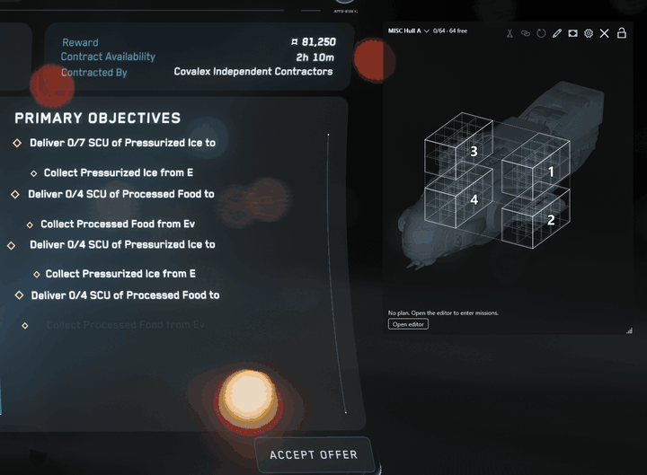

# SC-CargoPlan

A load-plan overlay for Star Citizen haulers: it decides which destination goes into which rack before you load, and
shows it in a translucent window next to the game.

<!-- SHOT: E1 -->

## Features

- One color per destination, one rack per destination where the ship allows it, every crate named in the legend.
- Contracts captured with ContractTracker come in by themselves; or type them in the editor.
- Drag, turn, split and merge crates to match what the cargo elevator really did.
- Mark each delivery loaded, then delivered at its stop; undo any step.
- Click-through while the game has the mouse. A separate window: nothing is injected into the game.
- 97 ships, with cargo grids from Fleetyards.

## Install

1. Download `SC-CargoPlan-v<version>-win-x64.zip` from the [latest release](https://github.com/MRiediger/sc-cargoplan/releases/latest).
2. Right-click it → **Extract All**.
3. Start `SC-CargoPlan\CargoPlan.App.exe`. Windows warns that the app is unsigned: **More info → Run anyway**.

Run Star Citizen in **Borderless** window mode; exclusive fullscreen covers the overlay.

## Requirements

- Windows 10/11 x64 (tested on Windows 11). Nothing else to install: .NET comes with it.
- Optional: [ContractTracker](https://www.nexusmods.com/starcitizen/mods/34) V2 to capture contracts.

## Documentation

- [Wiki](https://github.com/MRiediger/sc-cargoplan/wiki) ·
  [Quick start](https://github.com/MRiediger/sc-cargoplan/wiki/Quick-start-at-the-cargo-elevator) ·
  [Troubleshooting](https://github.com/MRiediger/sc-cargoplan/wiki/Troubleshooting)
- Bugs, wrong cargo grids, ideas: [Issues](https://github.com/MRiediger/sc-cargoplan/issues/new/choose) ·
  questions: [Discussions](https://github.com/MRiediger/sc-cargoplan/discussions)
- Build, test, contribute a ship: [CONTRIBUTING.md](CONTRIBUTING.md) · security: [SECURITY.md](SECURITY.md)

## Credits & disclaimer

- Cargo grid data from [fleetyards.net](https://fleetyards.net).
- [ContractTracker](https://www.nexusmods.com/starcitizen/mods/34) by Yuiki captures the contracts; SC-CargoPlan only
  reads its database.
- Stop colors: the [Okabe-Ito palette](https://jfly.uni-koeln.de/color/) and [Paul Tol's](https://sronpersonalpages.nl/~pault/) schemes.
- Not affiliated with Fleetyards, ContractTracker or CIG. Star Citizen is a trademark of Cloud Imperium Rights LLC.

[MIT](LICENSE). Not under MIT: the ship silhouettes ([`outlines/NOTICE.md`](outlines/NOTICE.md)) and the ship
holograms (`NOTICE.md` of the [`holo-v1` release](https://github.com/MRiediger/sc-cargoplan/releases/tag/holo-v1)).
