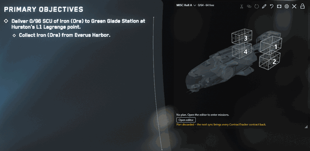
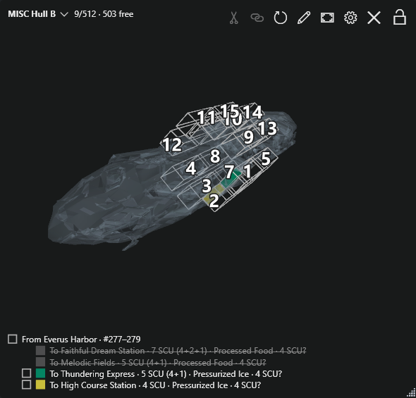

# SC-CargoPlan

A load-plan overlay for Star Citizen haulers: it decides which destination goes into which rack before you load, and
shows it in a translucent window next to the game.

<!-- SHOT: E1 -->

## Features

- One color per destination, one rack per destination where the ship allows it, every crate named in the legend.
- Optionally a block per destination in a shared rack, with a gap to get at the crates.
- Press F3 on an open contract: CargoPlan reads it itself and adds it to the plan; or type it in the editor.
- Drag, turn, split and merge crates to match what the cargo elevator really did.
- Mark each delivery loaded, then delivered at its stop; undo any step.
- Click-through while the game has the mouse. A separate window: nothing is injected into the game.
- 105 ships. Racks, hull and outline of 102 of them come from the game files; three still use Fleetyards data.

<!-- SHOT: H15 -->

## Install

1. Download `SC-CargoPlan-v<version>-win-x64.zip` from the [latest release](https://github.com/MRiediger/sc-cargoplan/releases/latest).
2. Right-click it → **Extract All**.
3. Start `SC-CargoPlan\CargoPlan.App.exe`. Windows warns that the app is unsigned: **More info → Run anyway**.

Run Star Citizen in **Borderless** window mode; exclusive fullscreen covers the overlay.

## Requirements

- Windows 10/11 x64 (tested on Windows 11). Nothing else to install: .NET comes with it.

## Known issues

Reading contracts is new in v0.4.0:

- Checked at 3440×1440 and 1920×1080 only. If a scan finds no contract on 32:9, 16:10 or 4K, start
  `CargoPlan.App.exe --keep-scans`, scan again and attach the picture from `%LocalAppData%\SC-CargoPlan\scans` to a
  [bug report](https://github.com/MRiediger/sc-cargoplan/issues/new?template=bug.yml).
- A contract whose destinations run past one mobiGlas page is read as far as it shows; the legend says
  `⚠ 1 of 3 destinations` when the contract tells.
- ContractTracker also reacts to F3: while it runs, CargoPlan says so. Pick another key or close ContractTracker.
- Two contracts with the same route and reward count as one: add the second in the editor.
- CargoPlan's windows over the contract blink briefly during a scan.
- After many scans CargoPlan uses up to about 900 MB of memory. Clear the scan key in the settings and the reader
  doesn't load at start.

All known issues: [Troubleshooting](https://github.com/MRiediger/sc-cargoplan/wiki/Troubleshooting#known-issues).

## Documentation

- [Wiki](https://github.com/MRiediger/sc-cargoplan/wiki) ·
  [Quick start](https://github.com/MRiediger/sc-cargoplan/wiki/Quick-start-at-the-cargo-elevator) ·
  [Troubleshooting](https://github.com/MRiediger/sc-cargoplan/wiki/Troubleshooting)
- Bugs, wrong cargo grids, ideas: [Issues](https://github.com/MRiediger/sc-cargoplan/issues/new/choose) ·
  questions: [Discussions](https://github.com/MRiediger/sc-cargoplan/discussions)
- Build, test, contribute a ship: [CONTRIBUTING.md](CONTRIBUTING.md) · security: [SECURITY.md](SECURITY.md)

## Credits & disclaimer

- Cargo grid data and ship models from [cryon.rocks (Motherlode)](https://cryon.rocks/ops/cargo), extracted from the
  Star Citizen game files and used with its operators' permission: the racks, the hull holograms and the outlines come
  from the same game data.
- Three ships (135c, 600i Executive Edition, F7C Hornet Mk II) still use hull data from
  [fleetyards.net](https://fleetyards.net): their grids, hologram and outline. Fleetyards' data made the first ship list
  possible.
- Thanks to both for letting this project use their data.
- Stop colors: the [Okabe-Ito palette](https://jfly.uni-koeln.de/color/) and [Paul Tol's](https://sronpersonalpages.nl/~pault/) schemes.
- Not affiliated with Motherlode, Fleetyards or CIG. Star Citizen is a trademark of Cloud Imperium Rights LLC.

[MIT](LICENSE). Not under MIT: the ship silhouettes ([`outlines/NOTICE.md`](outlines/NOTICE.md)) and the ship
holograms (`NOTICE.md` of the [`holo-v2` release](https://github.com/MRiediger/sc-cargoplan/releases/tag/holo-v2)).
